# NSE Quant Research Lab

**Five reproducible studies on Indian equity markets — risk modelling, trend following, statistical
arbitrage, factor investing and portfolio construction — built on real NSE end-of-day data through
2026-09-25.**

Every number in this README is generated by code (`scripts/build_readme.py` reads `reports/results/*.json`).
Every backtest is net of transaction costs, uses only information available at the time, earns the
NSE overnight rate on idle cash, and is tested for statistical significance — not just plotted.

> Python · pandas · NumPy · SciPy · statsmodels · `arch` (GARCH) · scikit-learn (Ledoit-Wolf) · Jupyter

---

## Headline findings

| # | Study | Finding |
|---|---|---|
| 1 | Market risk | NIFTY 50 daily returns have excess kurtosis of **16.7**: **18** moves beyond ±4σ vs **0.2** expected under normality. Of five 99% VaR models, **only GJR-GARCH with skewed-t errors passes both regulatory backtests** (Kupiec & Christoffersen). Volatility responds *only* to bad news (γ = 0.134, α ≈ 0). |
| 2 | Trend following | The 50/200 "golden cross" compounded **5.7%** vs **10.9%** for buy-and-hold, with a *deeper* drawdown. **Volatility targeting cut max drawdown from -38% to -20%** and raised Calmar from 0.28 to 0.38. Only 2 of 55 SMA pairs beat buy-and-hold; Deflated Sharpe of the best = 0.75 (not significant). |
| 3 | Pairs trading | HDFC Bank / ICICI Bank is **not cointegrated** (Engle-Granger p = 0.34; cointegrated in only 12% of rolling 1-yr windows). A rolling out-of-sample scanner over 78 bank pairs **lost 2.7% a year** net of costs despite being market-neutral (β = 0.06). |
| 4 | Factor investing | **Survivorship bias measured:** over 2017-2026, today's NIFTY 50 names equal-weighted compounded **18.1%** a year vs **11.5%** for NSE's point-in-time NIFTY50 Equal Weight index — **6.7 pp a year of pure hindsight**. Low-volatility was *inverted* in large caps. An India-specific **delivery-surge** signal and 1-month **reversal** were the only signals with \|IC t\| > 2; combined (exploratory) they earned +8.1%/yr over the equal-weight universe (t = 2.65, Deflated Sharpe 0.99). |
| 5 | Portfolio construction | Across 10 sectors + G-Sec + gold, **Equal risk contribution** had the best out-of-sample Sharpe (**0.67** vs 0.41 for NIFTY) with max drawdown -19% vs -38%. Markowitz max-Sharpe put 42% in a single asset and turned over 16% of the book a month. |

### What this project does differently from a typical student backtest

| Typical shortcut | Here |
|---|---|
| Hedge ratio / parameters fitted on the whole sample | Rolling formation → out-of-sample trading; Kalman filter; walk-forward parameter selection |
| No costs, cash earns 0% | 10 bps per side; idle cash earns the NIFTY 1D Rate Index (overnight TREPS) |
| Report the best parameter set | Report the full grid, **Probabilistic & Deflated Sharpe Ratios**, block-bootstrap Sharpe CIs |
| "It's cointegrated" asserted | Engle-Granger tested on rolling windows; half-life of mean reversion estimated |
| Today's index members back-tested | Survivorship bias **quantified** against NSE's point-in-time indices |
| One volatility number | GARCH, GJR-GARCH, five VaR models with Kupiec & Christoffersen backtests |
| Narrative written before results | Null and negative results reported as found |

---

## 01 · Market Risk & Regime Lab — [`notebooks/01_market_risk.ipynb`](notebooks/01_market_risk.ipynb)

NIFTY 50, Feb-2012 → 2026-09-25: CAGR 10.4% (price index), volatility 16.0%, skew -1.09.
Worst day -13.0% (2020-03-23).

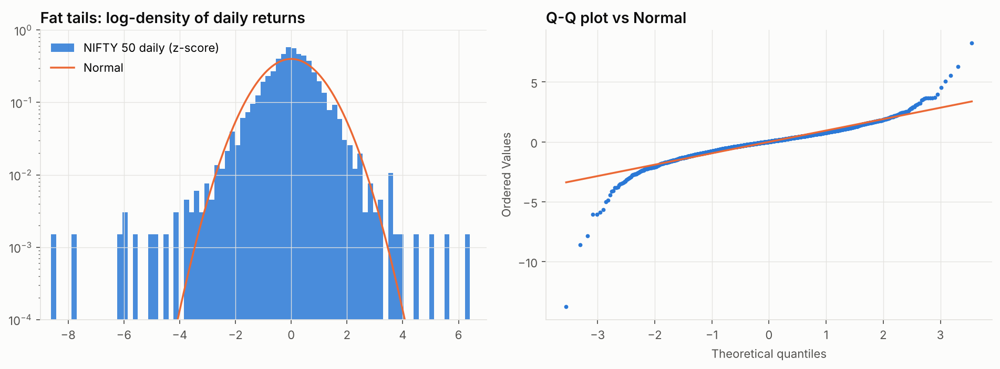

**Volatility model.** GARCH(1,1)-t persistence 0.97 → a volatility shock has a half-life of
**27 trading days**. Long-run vol 14.8%; current conditional vol 12.4%; peak 80.4% on 2020-03-24.
GJR-GARCH with skewed-t is preferred by both AIC (9056 vs 9158) and BIC.

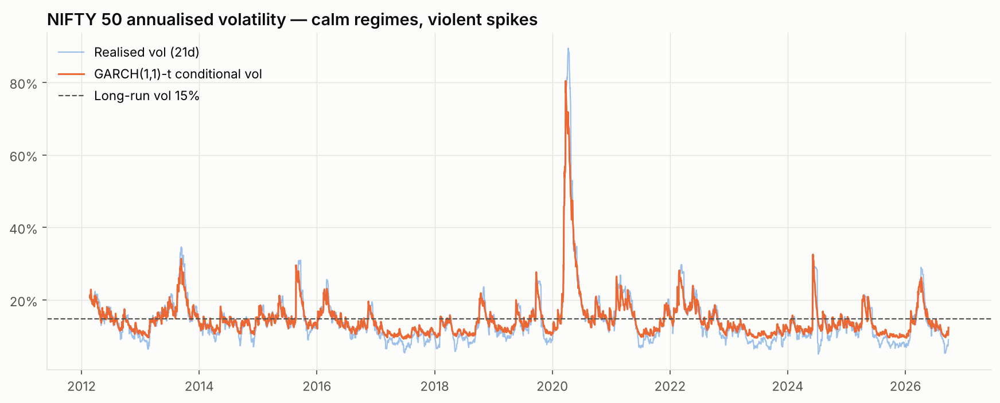

**99% one-day VaR, backtested out-of-sample over 3,100 days:**

| Model | Breaches | Expected | Kupiec p | Christoffersen p | Verdict |
|---|---:|---:|---:|---:|:---:|
| Historical | 38 | 31 | 0.222 | 0.001 | ❌ FAIL |
| Normal | 54 | 31 | 0.000 | 0.002 | ❌ FAIL |
| Cornish-Fisher | 18 | 31 | 0.011 | 0.004 | ❌ FAIL |
| GARCH-t | 47 | 31 | 0.007 | 0.744 | ❌ FAIL |
| GJR-GARCH skew-t | 32 | 31 | 0.857 | 0.414 | ✅ PASS |

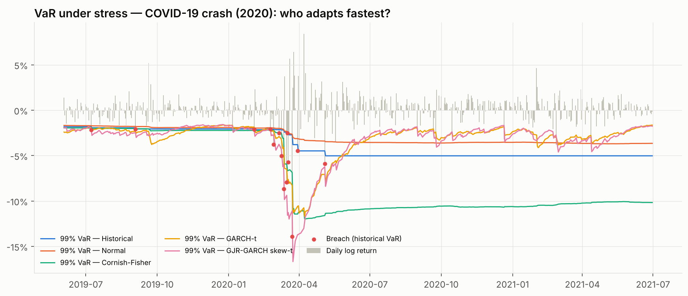

**Largest drawdowns**

| Peak | Trough | Depth | Days to trough | Days to recover |
|---|---|---:|---:|---:|
| 2020-01-15 | 2020-03-23 | -38.4% | 48 | 165 |
| 2015-03-04 | 2016-02-25 | -22.5% | 256 | 273 |
| 2021-10-19 | 2022-06-17 | -17.2% | 173 | 114 |
| 2024-09-27 | 2025-03-04 | -15.8% | 112 | 218 |
| 2026-01-05 | 2026-03-30 | -15.2% | 60 | not yet |

**Valuation.** Index P/E (z-scored within NSE's pre/post Apr-2021 earnings methodology) showed **no reliable
link** to next-3-year returns (ρ = +0.14, overlap-adjusted t = 0.34) — a null result reported as such.
Current NIFTY P/E: 19.6 — lower than on 99% of trading days since the Apr-2021 methodology change.

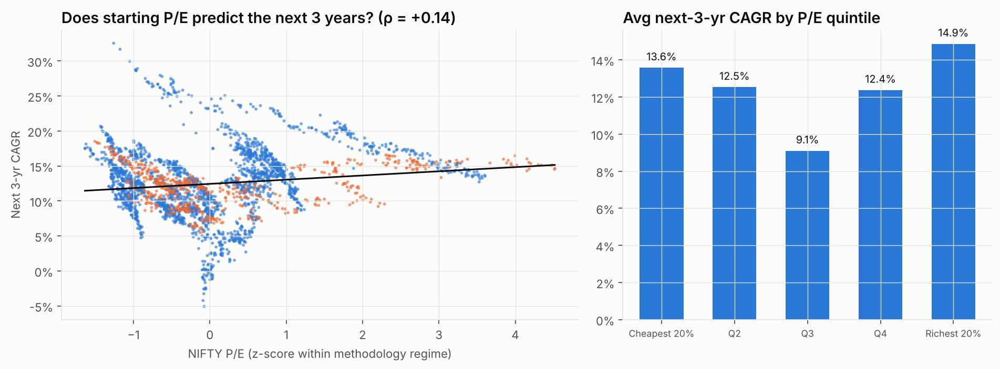

---

## 02 · Trend Following, Done Properly — [`notebooks/02_trend_following.ipynb`](notebooks/02_trend_following.ipynb)

| Strategy | CAGR | Volatility | Sharpe | Sortino | Max DD | Calmar |
|---|---:|---:|---:|---:|---:|---:|
| NIFTY 50 buy & hold | 10.9% | 16.2% | 0.38 | 0.52 | -38.4% | 0.28 |
| SMA 50/200 — naive (no costs, 0% cash) | 4.2% | 12.2% | -0.06 | -0.08 | -42.4% | 0.10 |
| SMA 50/200 — realistic | 5.7% | 12.2% | 0.06 | 0.07 | -40.3% | 0.14 |
| Vol-target 12% | 7.7% | 11.7% | 0.22 | 0.30 | -20.5% | 0.38 |
| Trend × Vol-target | 5.6% | 9.9% | 0.04 | 0.05 | -26.8% | 0.21 |

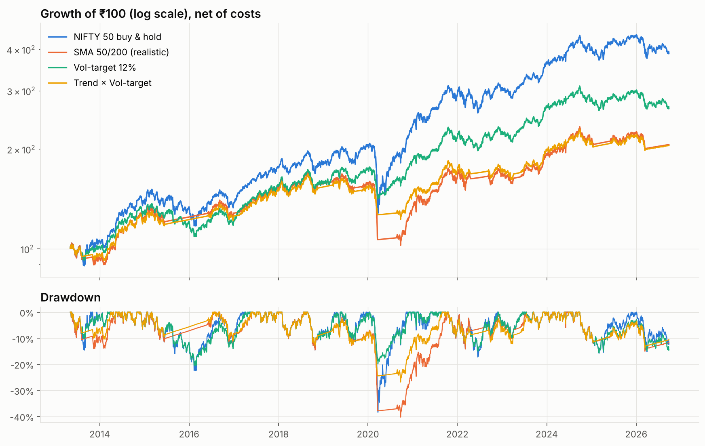

The crossover whipsawed through 2018-19, sold only *after* the March-2020 crash and missed the V-shaped
rebound. **Parameter grid (55 combinations):** median Sharpe 0.15; best 10/100 = 0.44;
Probabilistic Sharpe 0.95, **Deflated Sharpe 0.75** (< 0.95 → can't rule out luck).
95% bootstrap CI for buy-and-hold Sharpe: [-0.18, 0.94] — even 13 years of data can't pin a Sharpe ratio down tightly.

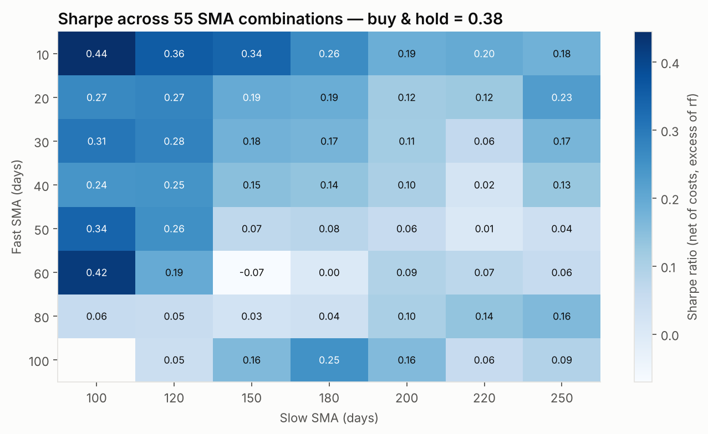

**Walk-forward** (re-pick parameters each January from the prior 5 years): CAGR 6.1% vs 11.5% buy-and-hold, Sharpe 0.11 vs 0.42.

**Robustness across 12 sectors** (trend × 12% vol target):

| Sector | B&H Sharpe | Strategy Sharpe | B&H Max DD | Strategy Max DD |
|---|---:|---:|---:|---:|
| PSU Bank | 0.21 | 0.32 | -75% | -23% |
| Pharma | 0.37 | 0.45 | -53% | -12% |
| Metal | 0.42 | 0.42 | -64% | -18% |
| Auto | 0.48 | 0.46 | -62% | -21% |
| Media | -0.11 | -0.18 | -73% | -15% |
| FMCG | 0.21 | 0.08 | -32% | -27% |
| Realty | 0.29 | 0.16 | -56% | -20% |
| IT | 0.39 | 0.24 | -44% | -20% |
| Infra | 0.32 | 0.14 | -44% | -21% |
| Fin Serv | 0.42 | 0.15 | -44% | -20% |
| Energy | 0.41 | 0.14 | -41% | -22% |
| Bank | 0.37 | 0.07 | -48% | -25% |

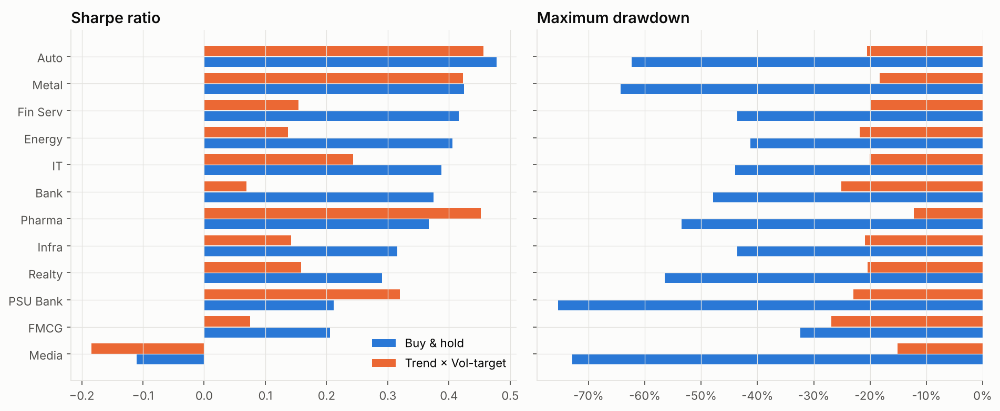

---

## 03 · Statistical Arbitrage in Indian Banks — [`notebooks/03_pairs_trading.ipynb`](notebooks/03_pairs_trading.ipynb)

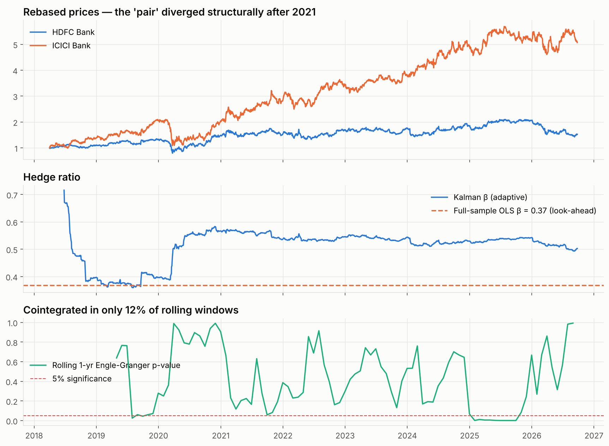

Scanner: every 6 months, test all 78 pairs of 13 banks on the past 252 days (Engle-Granger p < 0.05,
half-life 5-40 days), trade the top 5 for the next 126 days (entry |z|>2, exit |z|<0.5, stop |z|>4).
59 pairs selected over 15 windows; pair win rate 47%.

| Strategy | CAGR | Volatility | Sharpe | Max DD | Beta | Corr to NIFTY | Alpha (ann.) | Alpha t-stat |
|---|---:|---:|---:|---:|---:|---:|---:|---:|
| NIFTY 50 | 9.9% | 17.5% | 0.34 | -38.4% | — | — | — | — |
| Bank pairs scanner (OOS) | -2.7% | 9.1% | -0.82 | -23.7% | 0.06 | 0.12 | -7.8% | -2.32 |

| Cost per side | CAGR | Sharpe |
|---|---:|---:|
| 0 bps | 1.4% | -0.37 |
| 5 bps | -0.7% | -0.59 |
| 10 bps | -2.7% | -0.82 |
| 20 bps | -6.6% | -1.27 |

Even at zero cost the scanner earned less than the overnight rate: cointegration found in one 12-month window
mostly did not persist into the next six. A real edge would need intraday data or pairs with a structural
link (holding company vs subsidiary, ETF vs basket).

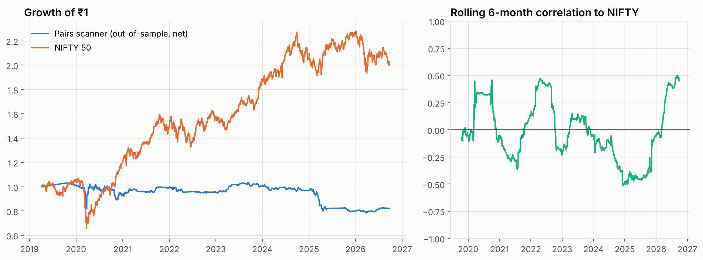

---

## 04 · Factor Investing in NIFTY 50 Stocks — [`notebooks/04_factor_investing.ipynb`](notebooks/04_factor_investing.ipynb)

Monthly rebalance, 46 stocks, quintile portfolios net of 10 bps. Information Coefficient = Spearman
correlation of signal vs next-month return.

| Signal | Months | Mean IC | IC t-stat | % months IC>0 | Top-quintile CAGR | Universe CAGR |
|---|---:|---:|---:|---:|---:|---:|
| Momentum 12-1 | 128 | +0.019 | **+0.88** | 52% | 21.5% | 19.2% |
| Low volatility | 128 | -0.041 | **-2.01** | 48% | 12.1% | 18.3% |
| Short-term reversal | 128 | +0.052 | **+2.75** | 58% | 24.1% | 18.3% |
| Delivery surge | 75 | +0.049 | **+2.15** | 61% | 28.3% | 23.7% |
| Composite (Mom + LowVol) | 128 | -0.006 | **-0.31** | 49% | 15.6% | 19.2% |

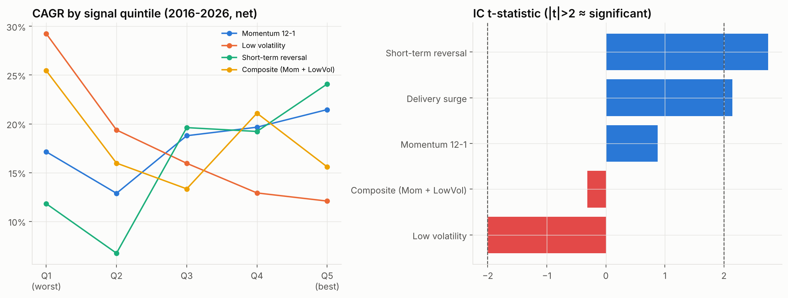

**Survivorship bias, same window:** current members equal-weighted 18.1% CAGR vs NIFTY50 Equal Weight index 11.5% vs NIFTY 50 10.4% (2017-05-01 → 2026-09-25).

**Survivorship-free check with NSE's own factor indices:**

| NSE index | vs | Since | Years | CAGR | Parent CAGR | Max DD | Parent Max DD | Alpha | t-stat |
|---|---|---|---:|---:|---:|---:|---:|---:|---:|
| NIFTY50 Equal Weight | NIFTY 50 | 2017-04 | 9.3 | 11.7% | 10.6% | -41% | -38% | +1.3% | 0.81 |
| NIFTY100 Low Volatility 30 | NIFTY 100 | 2016-07 | 10.0 | 11.0% | 10.9% | -31% | -38% | +1.1% | 0.68 |
| NIFTY200 Momentum 30 | NIFTY 200 | 2020-08 | 6.0 | 16.5% | 14.6% | -32% | -18% | +0.8% | 0.23 |
| NIFTY200 Quality 30 | NIFTY 200 | 2018-04 | 8.3 | 9.3% | 10.8% | -30% | -38% | -0.3% | -0.12 |
| NIFTY Alpha 50 | NIFTY 200 | 2012-11 | 13.5 | 20.4% | 12.2% | -41% | -38% | +7.4% | 2.27 |
| NIFTY50 Value 20 | NIFTY 50 | 2015-11 | 10.7 | 11.5% | 10.6% | -31% | -38% | +1.6% | 0.75 |

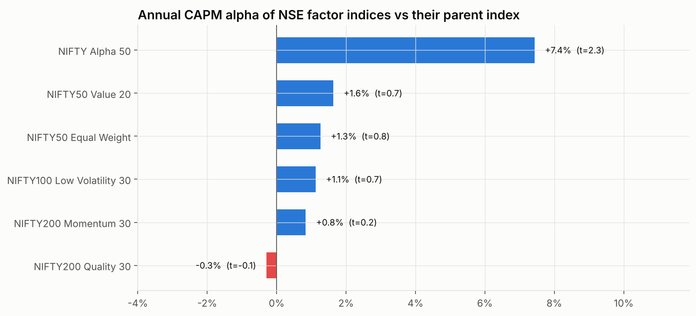

**Exploratory (in-sample) composite — Reversal + Delivery surge, top quintile, Jul-2020 onward:**

| Strategy | CAGR | Volatility | Sharpe | Max DD | Beta | Alpha (ann.) | Alpha t-stat |
|---|---:|---:|---:|---:|---:|---:|---:|
| NIFTY 50 index | 14.2% | 14.2% | 0.64 | -16.9% | — | — | — |
| Equal-weight universe (same stocks) | 23.7% | 14.5% | 1.18 | -16.6% | 0.97 | +8.4% | 4.57 |
| Reversal + Delivery, top quintile | 33.2% | 16.0% | 1.55 | -18.5% | 0.94 | +16.3% | 4.40 |

Alpha vs equal-weight universe +8.1% (t = 2.65); Deflated Sharpe 0.99 after 6 trials;
average monthly turnover 66%. Labelled exploratory because the signals were combined after seeing
their ICs — it needs forward paper-trading before real capital.

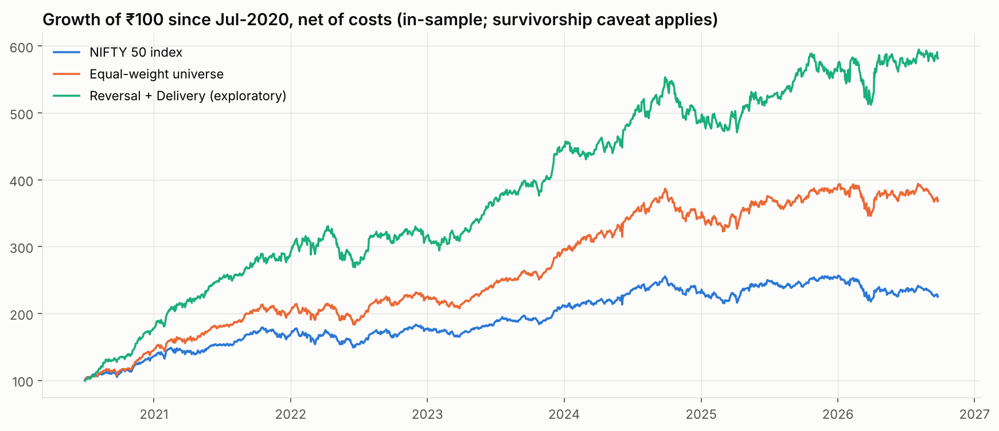

---

## 05 · Portfolio Construction — [`notebooks/05_portfolio_construction.ipynb`](notebooks/05_portfolio_construction.ipynb)

Assets: Bank, IT, FMCG, Pharma, Auto, Metal, Energy, Realty, Infra, Media, G-Sec 10Y, Gold. Walk-forward: 252-day estimation window, monthly rebalance, long-only, 10 bps.
Average correlation between equity sectors: 0.52.

| Strategy | CAGR | Volatility | Sharpe | Sortino | Max DD | Calmar | Beta |
|---|---:|---:|---:|---:|---:|---:|---:|
| NIFTY 50 (100% equity) | 11.3% | 16.2% | 0.41 | 0.56 | -38.4% | 0.29 | — |
| Equal weight | 12.4% | 14.1% | 0.52 | 0.70 | -35.8% | 0.35 | 0.80 |
| Max Sharpe (Markowitz) | 10.4% | 9.5% | 0.53 | 0.72 | -16.6% | 0.62 | 0.31 |
| Minimum variance | 7.6% | 4.4% | 0.48 | 0.68 | -7.7% | 0.99 | 0.14 |
| Inverse volatility | 10.7% | 9.7% | 0.55 | 0.73 | -25.0% | 0.43 | 0.55 |
| Equal risk contribution | 11.0% | 8.2% | 0.67 | 0.91 | -19.4% | 0.57 | 0.44 |
| Hierarchical risk parity | 8.3% | 5.3% | 0.52 | 0.71 | -12.4% | 0.67 | 0.24 |

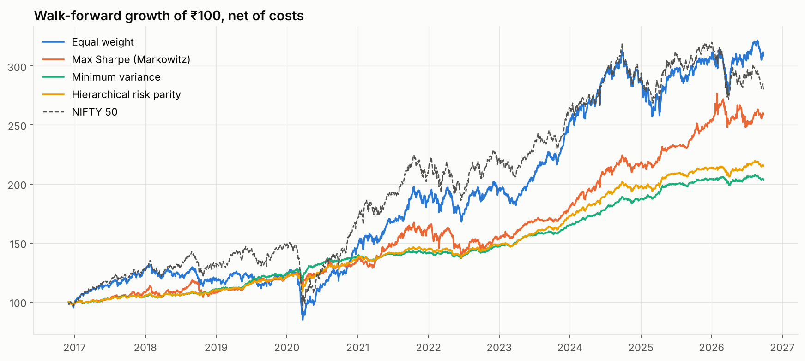

**Stress tests:**

| Episode | Equal weight | Max Sharpe (Markowitz) | Minimum variance | Inverse volatility | Equal risk contribution | Hierarchical risk parity | NIFTY 50 |
|---|---:|---:|---:|---:|---:|---:|---:|
| COVID crash (Feb-Mar 2020) | -31.3% | -7.4% | -6.9% | -23.7% | -18.6% | -11.8% | -36.5% |
| Rate-hike drawdown (Oct-21 to Jun-22) | -14.0% | -14.8% | -4.2% | -9.7% | -7.4% | -6.0% | -16.6% |
| FPI sell-off (Sep-24 to Mar-25) | -17.0% | -3.4% | -0.5% | -8.9% | -8.8% | -3.3% | -15.1% |
| 2026 correction (Jan-Mar 2026) | -10.6% | -1.1% | -1.3% | -7.1% | -5.7% | -2.9% | -15.2% |

**Current weights (as of 2026-09-25):**

| Asset | Equal weight | Max Sharpe (Markowitz) | Minimum variance | Inverse volatility | Equal risk contribution | Hierarchical risk parity |
|---|---:|---:|---:|---:|---:|---:|
| Bank | 8% | 0% | 0% | 7% | 5% | 2% |
| IT | 8% | 0% | 3% | 5% | 7% | 3% |
| FMCG | 8% | 0% | 8% | 8% | 8% | 5% |
| Pharma | 8% | 42% | 3% | 8% | 8% | 7% |
| Auto | 8% | 0% | 0% | 6% | 4% | 1% |
| Metal | 8% | 15% | 0% | 5% | 4% | 2% |
| Energy | 8% | 0% | 5% | 7% | 6% | 2% |
| Realty | 8% | 0% | 0% | 4% | 3% | 1% |
| Infra | 8% | 0% | 0% | 8% | 5% | 2% |
| Media | 8% | 0% | 0% | 5% | 5% | 2% |
| G-Sec 10Y | 8% | 29% | 80% | 34% | 40% | 69% |
| Gold | 8% | 14% | 1% | 4% | 5% | 2% |

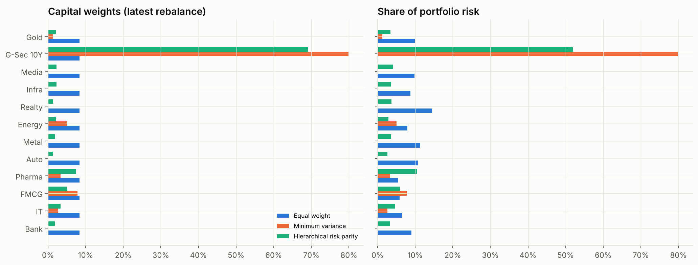
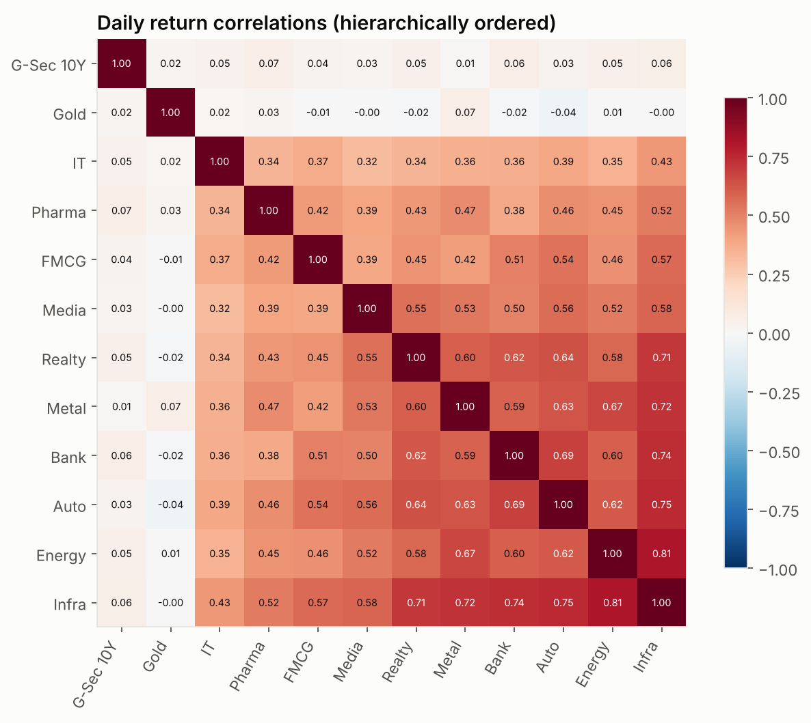

---

## Methodology notes

* **No look-ahead.** Signals use data up to the close of day *t*; positions are held from *t+1*. Pair
  selection, factor ranks, covariance estimates and strategy parameters are all estimated on past windows only.
* **Costs.** 10 bps per side per unit of turnover (brokerage + STT + exchange charges + slippage for liquid
  large caps/ETFs). Pairs-trading sensitivity reported from 0 to 20 bps.
* **Risk-free rate.** NIFTY 1D Rate Index (overnight collateralised lending), 6.5% p.a. before Jun-2016.
* **Price returns.** Stock and index series exclude dividends (~1.2-1.5% a year for NIFTY), so comparisons
  are price-vs-price. G-Sec index returns include accrued interest.
* **Survivorship.** Single-stock studies use current constituents; the bias is quantified (module 04) and
  every factor portfolio is benchmarked against the equally biased equal-weight universe.
* **Statistics.** Newey-West (HAC) t-stats for alpha; block-bootstrap Sharpe CIs; Probabilistic and Deflated
  Sharpe Ratios (Bailey & López de Prado); Kupiec POF and Christoffersen independence tests for VaR.

## Repository layout

```
nse-quant-lab/
├── notebooks/          executed Jupyter notebooks (rendered on GitHub)
├── research/           the same studies as plain .py (jupytext percent format)
├── src/nql/            data loaders, metrics & significance tests, chart style
├── reports/figures/    all charts      reports/results/  machine-readable results (JSON)
├── data/raw/           NSE EOD CSVs used by the studies
└── scripts/            fetch_data.sh · run_all.sh · build_readme.py
```

## Reproduce

```bash
pip install -r requirements.txt
bash scripts/fetch_data.sh   # optional: refresh data to the latest trading day
bash scripts/run_all.sh      # re-executes all notebooks and rebuilds this README
```

## Limitations & next steps

* Daily close-to-close data only; intraday execution, impact and borrow costs for futures-based shorts are approximated.
* Point-in-time constituent lists would remove survivorship bias from the single-stock studies entirely.
* Natural extensions: fundamental factors (earnings quality, value) from annual reports; a regime-switching
  (Markov) allocation layer; forward paper-trading of the delivery-surge signal.

## Data

NSE end-of-day bhavcopy and index data via the open-source
[eod2_data](https://github.com/BennyThadikaran/eod2_data) mirror (split/bonus-adjusted equities; one unadjusted
GOLDBEES split corrected in code). For research and education only — not investment advice.
